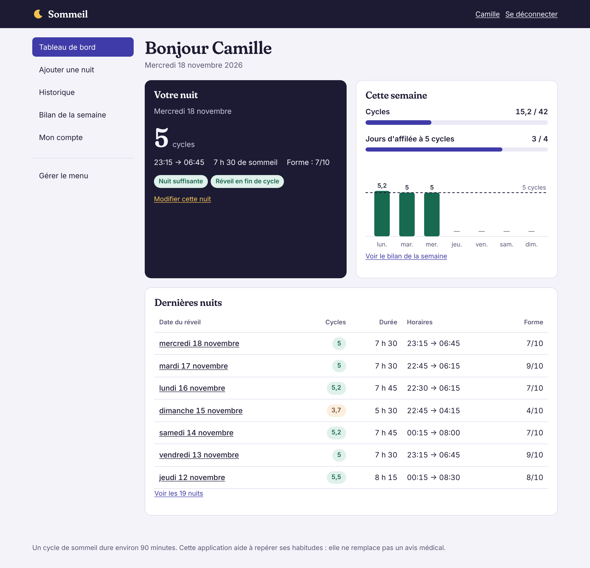
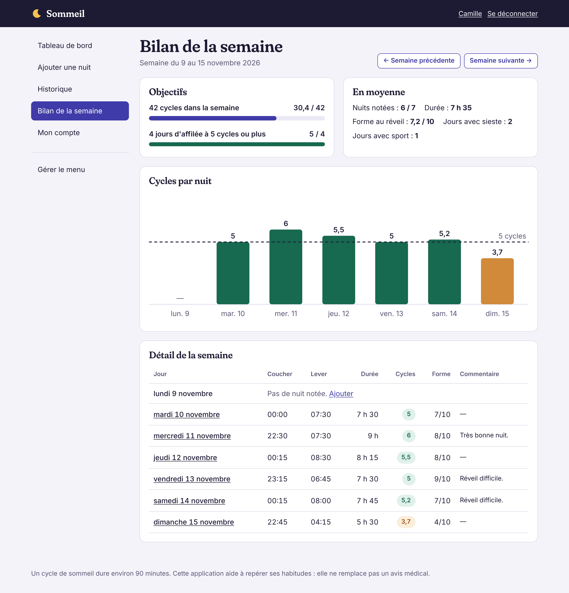

# Suivi du sommeil – CakePHP

Application web de suivi du sommeil par cycles de 90 minutes. Chaque matin, on note l'heure du coucher et du lever : l'application calcule la durée et le nombre de cycles, indique si le réveil est tombé en fin de cycle et suit deux objectifs sur la semaine.

C'était le projet du TP CakePHP de licence professionnelle DLWM, rendu en décembre 2024. Je l'ai ensuite réécrit sur CakePHP 5.4, surtout pour corriger le contrôle d'accès : un utilisateur pouvait lire ou modifier les nuits des autres.

Sur la [démo en ligne](https://suivi-sommeil.onrender.com), le bouton « Essayer la démo » crée un compte rien qu'à vous, avec trois semaines de nuits déjà saisies. Elle est hébergée gratuitement sur Render : le premier chargement peut prendre une minute.

<table>
  <tr>
    <td></td>
    <td></td>
  </tr>
</table>

## Fonctionnalités

- Saisie d'une nuit : heures de coucher et de lever, forme au réveil, siestes et sport. Dès que l'heure du coucher est saisie, le formulaire propose les heures de réveil qui tombent en fin de cycle.
- Tableau de bord et bilan de chaque semaine, avec un graphique des cycles par nuit.
- Historique paginé et triable.
- Gestion du compte, jusqu'à la suppression de toutes ses données.
- Menu de navigation modifiable par les administrateurs.

Les règles retenues : une nuit suffisante compte au moins 5 cycles, l'objectif de la semaine est de 42 cycles, et la régularité demande 4 jours d'affilée à 5 cycles ou plus. Un réveil est « en fin de cycle » à 0,2 cycle près (4,9 ou 5,1 cycles, mais pas 5,5). Une nuit est rattachée à la date du réveil.

**Stack** : PHP 8.2+, CakePHP 5.4 avec les plugins Authentication et Authorization, MySQL ou MariaDB (SQLite pour les tests et la démo), graphiques SVG générés côté serveur, PHPUnit, Docker.

## Ce que j'ai corrigé

- **Accès aux données des autres** : la liste affichait les nuits de tous les utilisateurs, et une nuit d'un autre compte se consultait, se modifiait ou se supprimait en changeant l'identifiant dans l'adresse. La gestion des comptes et du menu était ouverte à tout utilisateur connecté.
- **Prise de contrôle de compte** : la page publique de mot de passe oublié remplaçait le mot de passe de n'importe quel compte à partir de son email, puis l'affichait à l'écran.
- **Secret dans le dépôt** : `config/app_local.php` et sa clé de sécurité étaient versionnés. Le fichier a été retiré de l'historique et la clé n'est plus utilisée.
- **Projet incomplet** : le dossier `webroot` manquait, l'application ne pouvait pas être lancée depuis le dépôt.
- **Bilan faux** : les jours d'affilée étaient comptés sur les nuits saisies et non sur le calendrier, si bien qu'un jour oublié ne cassait pas la série.

## Sécurité

- Chaque requête passe par une vérification d'autorisation : une action qui l'oublierait renvoie une erreur au lieu d'ouvrir l'accès. Une nuit ne peut être lue, modifiée ou supprimée que par son propriétaire.
- Le propriétaire d'une nuit et le rôle d'un compte ne viennent jamais du formulaire, et les cycles sont recalculés par le serveur.
- Ancien mot de passe demandé pour le changer ou pour supprimer le compte, jeton CSRF sur chaque formulaire, en-têtes de sécurité (CSP stricte, `nosniff`, protection contre l'affichage dans une iframe).
- Le menu n'accepte que des chemins internes au site : un lien `javascript:` ou vers un autre site est refusé.

## Installation

Prérequis : PHP 8.2 ou plus récent avec les extensions `intl`, `mbstring`, `pdo_mysql` et `pdo_sqlite`, [Composer](https://getcomposer.org/) et un serveur MySQL ou MariaDB.

```bash
git clone https://github.com/MiscuitAtlas/suivi-sommeil-cakephp.git
cd suivi-sommeil-cakephp
composer install      # crée config/app_local.php avec une clé de sécurité aléatoire
```

Il reste à renseigner l'accès à la base dans `config/app_local.php` (bloc `Datasources.default`), puis :

```bash
mysql -u root -e "CREATE DATABASE suivi_sommeil CHARACTER SET utf8mb4 COLLATE utf8mb4_unicode_ci"
bin/cake migrations migrate
bin/cake seeds run DemoSeed     # facultatif : compte de démonstration et trois semaines de nuits
bin/cake server                 # http://localhost:8765
```

Le compte de démonstration est `demo@exemple.fr`, mot de passe `demo-sommeil`, avec le rôle administrateur.

La démo tourne aussi avec Docker, sans PHP ni base de données à installer :

```bash
docker build -t suivi-sommeil .
docker run --rm -p 8080:10000 suivi-sommeil    # http://localhost:8080
```

## Tests

```bash
composer test        # PHPUnit, sur une base SQLite temporaire
composer cs-check    # règles de codage CakePHP
```

Les 82 tests couvrent le calcul des cycles et des séries, le bilan de la semaine, la validation des formulaires et surtout les règles d'accès : chaque utilisateur ne voit et ne modifie que ses nuits, et le menu est réservé aux administrateurs.

## Structure

```
config/Migrations/   tables users, nights et menus
src/Service/         calcul des cycles et bilan de la semaine, sans dépendance au framework
src/Controller/      tableau de bord, nuits, comptes, menus, démo en ligne
src/Policy/          règles d'accès aux nuits et au menu
src/Middleware/      en-têtes de sécurité
templates/           pages, formulaire de nuit, graphique SVG
tests/               tests des services, des tables, des contrôleurs et des règles d'accès
```

## Limites

- Il n'y a plus de mot de passe oublié : la page de la première version a été supprimée, et la refaire proprement demanderait l'envoi d'emails.
- Un cycle compte toujours 90 minutes, alors que sa durée réelle varie d'une personne à l'autre.

## Ce que j'ai appris

- **Refuser par défaut** : avec le plugin Authorization, une action qui n'a pas vérifié les droits renvoie une erreur. Oublier une vérification ne peut plus ouvrir l'accès, ce qui était justement le problème de la première version.
- **Ne jamais lire le propriétaire dans le formulaire** : CakePHP remplit les entités avec les champs reçus. Sans liste de champs autorisés, un utilisateur pourrait s'attribuer la nuit d'un autre ou le rôle d'administrateur.
- **Un secret publié reste dans l'historique** : supprimer `app_local.php` du dépôt ne suffisait pas. Il a fallu réécrire l'historique et ne plus utiliser la clé.

## Crédits

Police [Fraunces](https://github.com/undercasetype/Fraunces) par Undercase Type, sous licence SIL Open Font License (voir `webroot/font/OFL-Fraunces.txt`).

## Auteur

Projet réalisé lors du TP CakePHP de licence professionnelle Développement Logiciel et Web Mobile (DLWM), puis réécrit.

**Maxence Français** : [portfolio](https://miscuitatlas.github.io) · [LinkedIn](https://www.linkedin.com/in/maxence-fran%C3%A7ais-a039a2307/)
